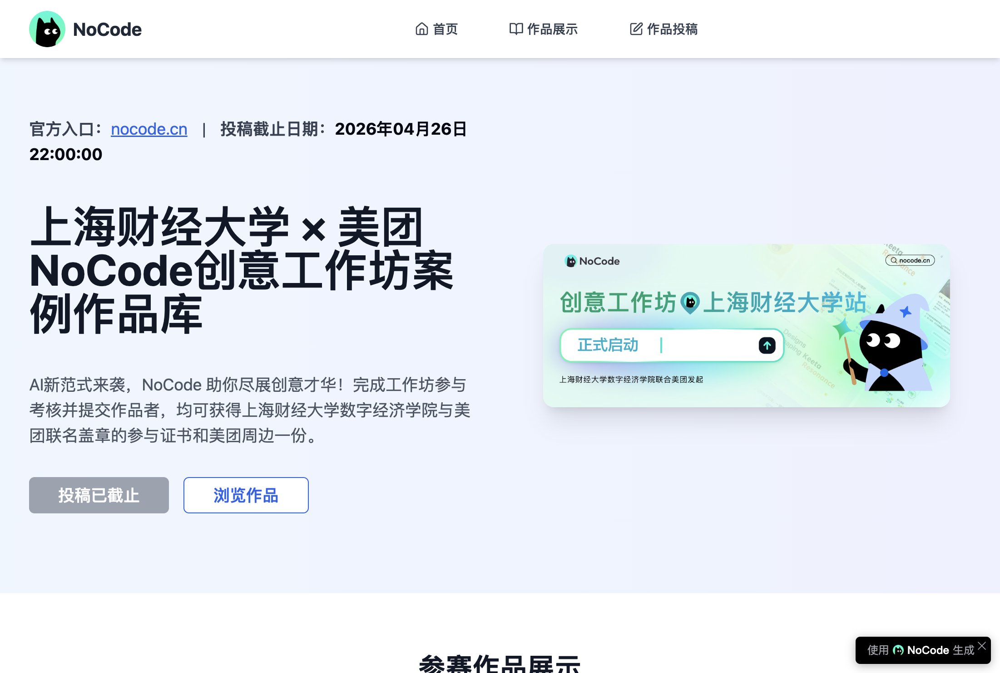
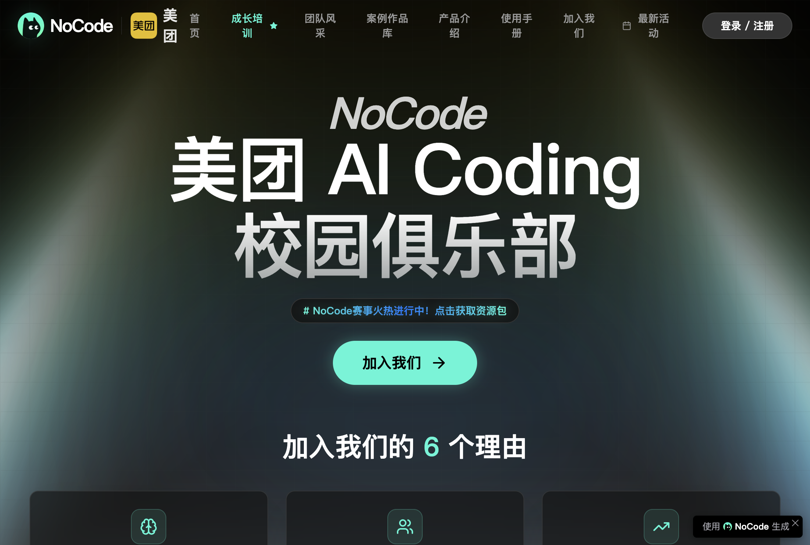
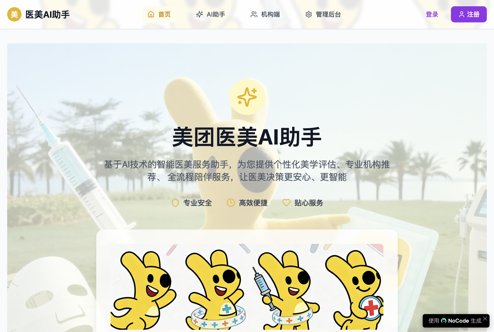
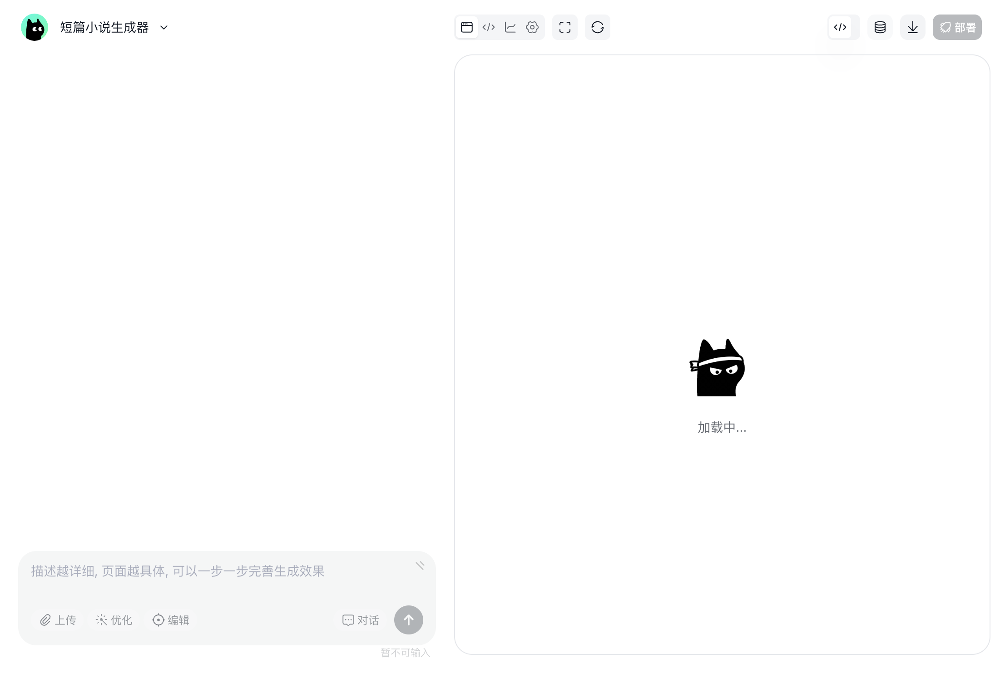

# Vibe Coding AI 产品作品集

这是王千硕使用 NoCode / Vibe Coding 完成的 AI 产品与活动页面作品集。

## 作品一：上海财经大学合作竞赛页面

- 在线页面：[打开页面](https://nocode.cn/#/chat?pageId=9z9vut1sglpxy8s6)
- 用途：上海财经大学合作竞赛 / 工作坊相关作品展示页
- 访问说明：当前链接需要 NoCode 任务访问权限，打开后可能显示权限提示。

## 作品二：美团 AI Coding 校园俱乐部

- 在线页面：[打开页面](https://ai-campus-club.nocode.host/)
- 用途：校园 AI 俱乐部品牌介绍、招募、活动与产品介绍
- 页面特点：包含俱乐部定位、加入理由、招聘流程、团队文化、NoCode 产品介绍和活动案例。

## 作品三：医美小团 AI 助手

- 在线页面：[打开页面](https://nocode.cn/#/chat?pageId=7aayi2k8k8tqjae3)
- 用途：面向医美咨询场景的个性化 AI 助手
- 页面特点：通过年龄、肤质等问题收集用户信息，并生成个性化建议方案。

## 作品四：短篇小说生成器

- 在线页面：[打开页面](https://nocode.cn/#/chat?pageId=5849awgg1myov696)
- 用途：根据题材、字数、人物和场景生成短篇小说
- 页面特点：支持题材选择、字数设置、自定义人物与场景，并保留 AI 对话生成能力。

## 我的贡献

- 独立完成需求拆解、页面结构设计、交互设计和提示词编排
- 使用自然语言驱动 Vibe Coding，从想法快速生成可访问页面
- 根据目标用户和使用场景持续调整页面信息架构与交互流程

> 这些项目主要用于展示产品思考、AI 工具使用能力和从 0 到 1 的快速实现能力。部分 NoCode 编辑器链接需要登录或任务权限，成品展示以在线页面和截图为准。
